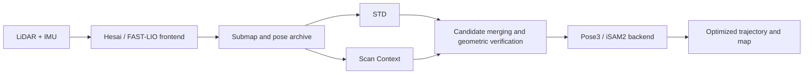

# LTA-OM-SC — ROS2

LiDAR-inertial SLAM for Hesai sensors, extending [LTA-OM](https://github.com/hku-mars/LTAOM) with **STD and Scan Context loop retrieval, shared geometric verification, and iSAM2 pose graph optimization**. ROS1 and ROS2 versions are available.

This branch: **`ros2` — Ubuntu 22.04 / ROS Humble**. See the [`ros1` branch](https://github.com/ShowUmezawa/ltaom-sc/tree/ros1) for the other version.

## Changes from LTA-OM

This project builds on LTA-OM's FAST-LIO frontend, STD descriptors, and iSAM2 optimization. The main changes are:

| Component | LTA-OM foundation | Changes in this project |
|---|---|---|
| LiDAR and IMU input | Examples for Ouster, Velodyne, Livox, and other sensors | Hesai 16/32-channel PointCloud2 support with double-precision absolute point timestamps, ring, and intensity; vehicle and quadruped robot presets |
| Timing and data association | Association of frontend poses, clouds, and submaps | Separate scan association time from state time; explicit IMU unit conversion and time offsets; checks for empty clouds, fields, scan duration, and synchronization boundaries |
| Loop retrieval | STD retrieval and geometric matching | Add Scan Context; share submap IDs and archives, merge candidates for the same pair, and provide STD-only, SC-only, and dual modes |
| Geometric verification | STD verification workflow | Shared Quatro and Nano-GICP verification for both sources, with checks for convergence, bidirectional overlap, residuals, spatial coverage, and geometric degeneracy |
| Backend constraints | Native point-pair constraints and optimization | Add robust Pose3 loop factors; the default pipeline uses odometry and verified loop edges, with adjacent corner constraints and native factor compression disabled |
| Optimization recovery and traceability | Existing optimization checks and recovery | Complete iSAM2 snapshot restoration, archive original factors and transactions, and support independent graph reconstruction and result checks |
| ROS platforms | Upstream documentation targets ROS1 Melodic | Separate Noetic and Humble branches; native ROS2 nodes, topics, and rosbag2 replay |
| Reproducibility and run completion | Existing build and run scripts | Pin frontend Eigen to 3.4.0, use deterministic point ordering within voxels and synchronous tree rebuilding, record code/configuration versions, and check input counts, queue draining, and map export; add ROS2 queue budgets, submap acknowledgements, and offline replay flow control |

## Pipeline



STD candidates provide a full initial pose; SC candidates provide retrieval results and yaw. Registration uses Nano-GICP for refinement and Quatro when coarse alignment is needed. Both sources use the same quality checks, and each submap pair contributes at most one verified loop constraint.

The frontend continuously produces real-time odometry. The backend uses loop constraints to generate an optimized trajectory and map. The replay entrypoint processes one mapping session at a time; backend corrections are not fed back into the frontend state.

## Environment and build

| Dependency | Branch configuration |
|---|---|
| OS / ROS | Ubuntu 22.04 / ROS Humble |
| Compiler / PCL | GCC 11.2 / PCL 1.12.1 |
| Frontend Eigen | 3.4.0, included in the repository |
| GTSAM / Ceres | 4.0.3 / 1.14.0, with the supplied patches |

Prepare the corresponding ROS development environment and dependencies, including OpenCV, PCL, TBB, Boost, SuiteSparse, glog, and gflags. See the [Dockerfile](docker/Dockerfile) for a system dependency installation example and [environment versions](locks/environment.json) for details. No prebuilt container image is published by this repository.

```bash
git clone --branch ros2 https://github.com/ShowUmezawa/ltaom-sc.git
cd ltaom-sc

# Fetch pinned GTSAM/Ceres sources and apply patches. Use a new cache directory.
python3 scripts/fetch_dependencies.py --cache "$PWD/cache"
bash scripts/build_dependencies.sh "$PWD/cache" "$PWD/deps_install" "$PWD/deps_build"

export LTAOM_DEPS_PREFIX="$PWD/deps_install"
export LTAOM_BUILD_DIR="$PWD/build"
bash scripts/build.sh
```

The build entrypoint checks the Eigen headers actually used by the frontend and writes build outputs to `build/install`. The Eigen pin applies to frontend compilation; other library versions follow the platform dependency configuration.

## Replay a ROS2 bag

Input is a rosbag2 directory containing `metadata.yaml` and SQLite segments. After building, run these commands in a terminal with the environment variables above set:

```bash
# Frontend only
bash scripts/replay.sh frontend --dataset car --bag /path/to/car_bag \
  --out "$PWD/results/car_frontend"

# STD + Scan Context + geometric verification + backend optimization
bash scripts/replay.sh full --dataset car --bag /path/to/car_bag \
  --mode dual --out "$PWD/results/car_dual"
```

For the full pipeline, `--mode` accepts `std_only`, `sc_only`, or `dual`. Use `--dataset dog` for the quadruped preset. The entrypoint uses native ROS2 nodes and `ros2 bag play` at 1× speed, pausing and resuming offline replay according to processing queue levels.

The entrypoint loads the [DDS configuration](config/large_data.xml) by default. Use `--shm-size 4g` when running the full pipeline in a container to provide shared memory for large submap messages. `ROS_LOCALHOST_ONLY=1` is the default for replay on a single machine.

## Input configuration

The Hesai adapter requires FLOAT32 `x/y/z/intensity`, FLOAT64 `timestamp` in absolute seconds, and UINT16 `ring`, with `lidar_type: 6` in the configuration. The supplied presets use:

| Preset | LiDAR topic | Input IMU topic | Acceleration handling |
|---|---|---|---|
| `car` | `/hesai/pandar` | `/imu/data` | Convert g to m/s² once at the entrypoint |
| `dog` | `/go2_research/hesai/points` | `/go2_research/body_imu/host` | Use m/s² directly |

Frontend configurations are in [src/ltaom_frontend/config/hesai](src/ltaom_frontend/config/hesai); geometric verification configurations are in [src/ltaom_pipeline/config](src/ltaom_pipeline/config). The `car` and `dog` presets contain dataset-specific extrinsics, time offsets, and filtering settings. Check these values, topics, and point timestamps for your own sensors. The quadruped preset uses the robot's body IMU.

For custom sensors, use `--sensor-config /path/to/profile.yaml` instead of `--dataset`. Templates are in [config/sensors](config/sensors). See the [sensor adaptation guide](docs/SENSOR_ADAPTATION.md) for fields, point timestamps, IMU units, extrinsics, noise settings, and parameter override rules.

## Outputs and checks

- Raw frontend trajectory in TUM format, plus a scan timestamp and ID manifest.
- Optimized trajectory and map: `optimized_poses.txt` and `cloud_result.pcd`.
- Loop records: candidate sources, registration results, acceptance/rejection reasons, and submap/loop IDs.
- Factor archive: `factor_transactions.jsonl`, for independent graph reconstruction and result checks.
- Run metadata: code commit, configuration summaries, message counts, processing state, and resource usage.

The replay entrypoint waits for every processing stage to finish and checks counts before exiting. Use a new output directory to avoid overwriting results. For numerical diagnostics, set `LTAOM_PARITY_CAPTURE=1` to record detailed intermediate results for the first 40 consumed scans and input digests for the full sequence.

## Input requirements and supported features

- Hesai 16/32-channel presets are provided. Use `--sensor-config` to specify topics, extrinsics, time offsets, IMU units, and algorithm settings.
- Replay accepts SQLite rosbag2 directories (`metadata.yaml` and `.db3` segments), using `PointCloud2` and `Imu` messages. Point fields and timestamps must follow the [sensor adaptation guide](docs/SENSOR_ADAPTATION.md).
- Scan Context registration requires gravity direction information. Candidates that do not meet the configured gravity quality requirements are excluded from loop verification.
- Failed trial optimization of a new loop can be rolled back. Online removal of previously accepted loops, PCM, and checkpoint/resume are not provided.

## Sources and licenses

Based on LTA-OM commit `aeb0bedcdfe4ec51e0d12f7b3804552e6066c0ae`, with upstream attribution and licenses retained. See the [upstream README](docs/UPSTREAM_LTAOM.md) for the original project and [third-party notices](docs/THIRD_PARTY.md) for Scan Context, Quatro, Nano-GICP, TEASER++, PMC, and other dependencies.
